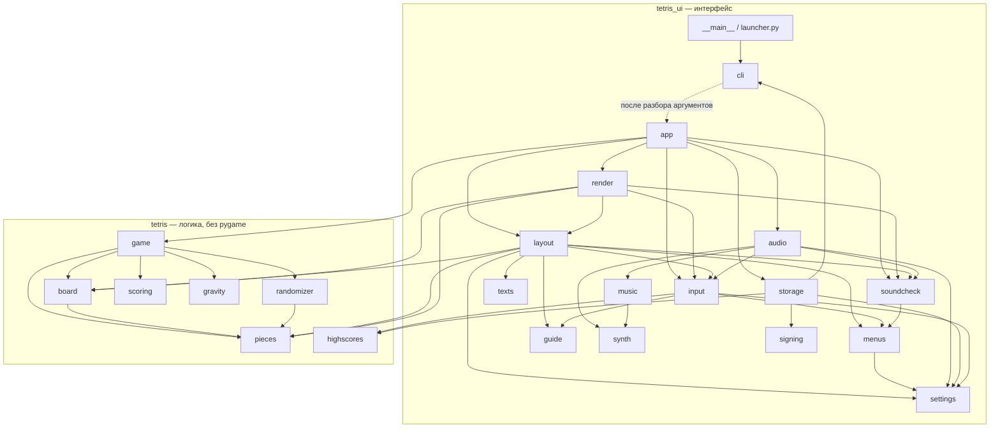
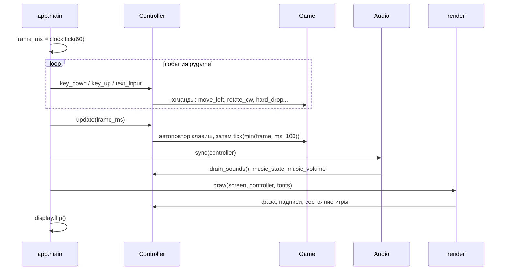
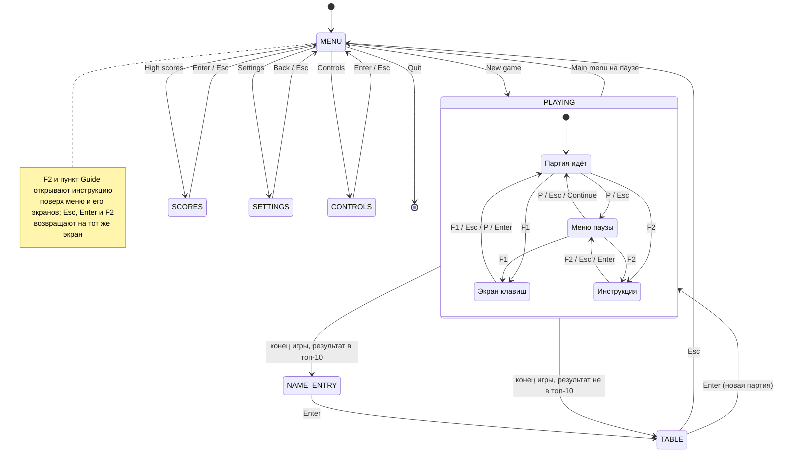

# Архитектура

## Главный принцип

Программа разделена на два пакета:

- **`tetris/` — логика игры.** Поле, фигуры, команды, очки, уровни, гравитация, правила таблицы рекордов. Чистый Python: без pygame, без файлов и без системных часов. Время приходит только через `Game.tick(dt_ms)`, случайность — через передаваемый `random.Random`. Поэтому логика детерминирована и полностью проверяется тестами. Тест [tests/test_architecture.py](../tests/test_architecture.py) следит, чтобы pygame сюда не попал.
- **`tetris_ui/` — интерфейс.** Окно, клавиатура, отрисовка, звук, хранение рекордов и настроек. Он только читает состояние логики и передаёт ей команды; правил игры в нём нет.

Внутри `tetris_ui/` тоже есть граница: модули `input`, `menus`, `texts`, `guide`, `layout`, `settings`, `synth`, `music`, `soundcheck`, `signing` не импортируют pygame и тестируются напрямую, а `app`, `render`, `audio` работают с pygame и проверяются дымовыми тестами с SDL-драйверами `dummy` (без окна и без звуковой карты).

## Зависимости модулей

Стрелки идут только из `tetris_ui` в `tetris`, обратных нет.

## Модули

| Модуль | Ответственность |
|---|---|
| `tetris/board.py` | Поле 10 × 22 (строки 0–1 скрыты): занятость клеток, удаление заполненных строк |
| `tetris/pieces.py` | Семь фигур, их ориентации, размеры рамок и позиции появления |
| `tetris/randomizer.py` | Генератор 7-bag: мешки по семь фигур |
| `tetris/game.py` | Партия: активная и следующая фигуры, команды, тень, фиксация, очки, гравитация, конец игры |
| `tetris/scoring.py` | Таблица очков за линии и расчёт уровня с учётом стартового |
| `tetris/gravity.py` | Таблица скоростей: кадров на строку по уровню |
| `tetris/highscores.py` | Правила таблицы рекордов: порядок, попадание, имя, записи для файла |
| `tetris_ui/input.py` | `Controller`: фазы экрана, клавиши, главное меню и его экраны, автоповтор, меню паузы, экран клавиш, инструкция, ввод имени, настройки, звуковые события кадра |
| `tetris_ui/menus.py` | Пункты главного меню и меню паузы, строки экрана настроек, правила изменения настроек, предустановки автоповтора (без pygame) |
| `tetris_ui/guide.py` | Инструкция в игре: заголовки страниц и абзацы на английском и русском (без pygame) |
| `tetris_ui/texts.py` | Русский перевод всех постоянных надписей и шаблоны надписей с числами и именем (без pygame) |
| `tetris_ui/layout.py` | Размеры, координаты и цвета, все надписи экрана на выбранном языке, ширины областей для надписей (без pygame) |
| `tetris_ui/render.py` | Рисование кадра на поверхности pygame, подбор размера шрифта под ширину области |
| `tetris_ui/app.py` | Окно, игровой цикл, перевод клавиш pygame в `Key`, сборка контроллера; цикл проверки звуков `run_sound_check()` и её клавиши |
| `tetris_ui/settings.py` | Настройки игрока (звук, язык, стартовый уровень, тень, автоповтор): значения по умолчанию, проверка, JSON |
| `tetris_ui/storage.py` | Папка данных, чтение и атомарная запись подписанной таблицы `highscores.json`, ID установки `install-id` и `settings.json`, запись отчёта проверки звуков `sound-check.json` |
| `tetris_ui/signing.py` | Подпись таблицы рекордов: HMAC-SHA256 ключом игры по номеру формата, ID установки и записям, проверка подписи (без pygame) |
| `tetris_ui/synth.py` | Синтезатор PCM на чистом Python (мягкие треугольные ноты с затуханием) и восемь звуковых эффектов |
| `tetris_ui/music.py` | Ноты фоновой мелодии и её синтез |
| `tetris_ui/audio.py` | Проигрывание эффектов и музыки через `pygame.mixer` или тишина без устройства, в том числе пунктов проверки звуков |
| `tetris_ui/soundcheck.py` | Проверка звуков: 13 пунктов и расписание их звуков, выбор пункта, отметки «неприятно», отсчёт времени по кадрам, текст отчёта (без pygame) |
| `tetris_ui/cli.py` | Разбор `--max-frames` и `--sound-check`, запуск игры или проверки звуков, безопасный вывод предупреждений |

## Один кадр

Игровой цикл — `app.main()`. Он ограничен 60 кадрами в секунду; каждый кадр проходит так:

Порядок важен: команды игрока выполняются до гравитации того же кадра, а время одного кадра ограничено 100 мс, чтобы после подвисания окна фигура не проваливалась на много строк сразу. Закрытие окна (`QUIT`) и пункт «Quit» главного меню (`Controller.quit_requested`) сразу завершают цикл с кодом 0.

Проверка звуков (`--sound-check`) крутит свой цикл — `app.run_sound_check()`, с тем же ограничением 60 кадров в секунду. В нём нет ни `Controller`, ни партии, ни `Audio.sync()`. Каждый кадр:
1. события pygame → `SoundCheck.key_down()`;
2. `audio.play_check(check.update(frame_ms))`;
3. `render.draw_sound_check()`.

Esc и закрытие окна завершают его с кодом 0. Подробнее — в [interface.md](interface.md).

## Фазы экрана

`Controller` знает, в какой фазе находится экран, и по фазе решает, что делают клавиши и что рисуется.

- **`MENU`** — главное меню при запуске: New game, High scores, Settings, Controls, Guide, Quit. Выделенный пункт — `menu_index`.
- **`SCORES`, `SETTINGS`, `CONTROLS`** — экраны меню: таблица рекордов, настройки, список клавиш. В меню и на его экранах время не идёт, музыки нет, работают только клавиши экрана и клавиши звука.
- **`PLAYING`** — партия. Пауза (`paused`) и экран клавиш (`help_open`) — состояния внутри неё: время и команды стоят, музыка на паузе. На паузе работает меню паузы (`pause_index`): «Main menu» бросает партию без записи результата.
- **Инструкция** (`guide_open`, `guide_page`) — не фаза, а флаг поверх меню, его экранов и партии. Её открывают F2 и пункт «Guide»; партия под ней ставится на паузу. Esc, Enter и F2 закрывают её и возвращают на тот же экран: партию — на паузу, главное меню — с выделенным «New game». После конца игры и на экране клавиш F2 не работает.
- **`NAME_ENTRY`** — ввод имени для таблицы рекордов.
- **`TABLE`** — таблица рекордов; Enter начинает новую партию сразу, Esc открывает главное меню.

Новая партия всегда начинается со стартового уровня из настроек: `game.new_game(settings.start_level)`.

Переход из `PLAYING` при конце игры происходит в свойстве `Controller.phase`, как только `game.is_over` стал истинным.

## Звуковые события

Логика не посылает событий. Контроллер сам выводит их: запоминает перед каждой командой и перед `update` снимок `(pieces_locked, lines, level, is_over)` и сравнивает со снимком после. Выросло число зафиксированных фигур — значит, была фиксация (звук `lock`, `clear` или `tetris` по числу удалённых линий); вырос уровень — `level_up`; партия закончилась — `game_over`. Успешные сдвиг и поворот дают `move` и `rotate`. `Audio.sync()` раз в кадр забирает накопленные события и проигрывает их. Подробнее — в [interface.md](interface.md).

## Данные на диске

Все данные лежат в папке данных пользователя (`storage.data_dir()`):

| Условие | Папка |
|---|---|
| задана переменная `TETRIS_DATA_DIR` (тесты, ручные проверки) | её значение |
| Windows | `%APPDATA%\tetris_shmetris` |
| иначе | `~/.local/share/tetris_shmetris` |

В ней три файла игры: `highscores.json` (таблица рекордов), `install-id` (ID установки) и `settings.json` (настройки звука и игры). Все пишутся атомарно — во временный файл и затем заменой. Повреждённые таблица и настройки читаются как пустая таблица и настройки по умолчанию, а испорченный или пропавший ID заменяется новым. Таблица подписана (`tetris_ui/signing.py`): HMAC-SHA256 ключом, зашитым в игру, по номеру формата, ID установки и записям. Таблица, исправленная вручную, скопированная из другой установки или записанная в прежнем формате, не проходит проверку и читается как пустая, с предупреждением в консоль. Режим проверки звуков пишет туда же, тоже атомарно, третий файл — `sound-check.json` с отметками «неприятно» (см. [interface.md](interface.md)); игра его не читает. Рядом с exe игра ничего не создаёт.

## Нормативные спецификации

Поведение, описанное здесь в общих чертах, точно задано в спецификациях: [game-screen](../openspec/specs/game-screen/spec.md), [controls](../openspec/specs/controls/spec.md), [audio](../openspec/specs/audio/spec.md), [high-scores](../openspec/specs/high-scores/spec.md), [distribution](../openspec/specs/distribution/spec.md), [main-menu](../openspec/specs/main-menu/spec.md), [settings](../openspec/specs/settings/spec.md), [localization](../openspec/specs/localization/spec.md), [in-game-guide](../openspec/specs/in-game-guide/spec.md), [game-version](../openspec/specs/game-version/spec.md).
